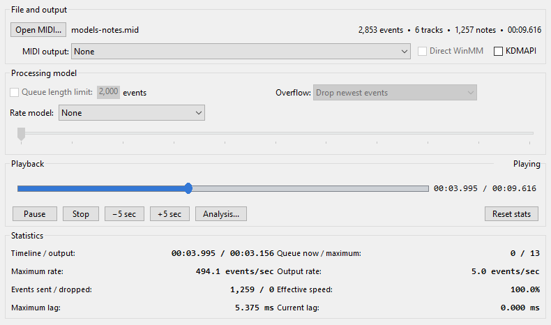

# MIDIBottleneck Player

MIDIBottleneck Player plays MIDI files and shows what happens when a very dense file meets an output that can only take so many messages per second, or a queue that can only hold so much. You can slow the output down on purpose, limit the queue, thin out note traffic, and watch the result live and in a prediction graph.

Version 2.0 is a complete rewrite of version 1 as a native Windows program. It keeps every feature of version 1.0.44 and improves on them (see [what is new](CHANGELOG.md)). This release is version 2.0.0; the About box reads "Release 2.0.0 • version 2.0.0.0".

**[Download the latest release](https://github.com/ray890/MIDIBottleneck-Player/releases/latest)**

Looking for version 1? It is kept unchanged in [`archive/v1`](archive/v1) and on the `v1-maintenance` branch. The last version 1 release is [v1.0.44](https://github.com/ray890/MIDIBottleneck-Player/releases/tag/v1.0.44).

## Important: no synthesizer is included

MIDIBottleneck Player sends MIDI messages; it does not make sound by itself. To hear anything you need a MIDI synthesizer or driver that you install yourself, for example:

- a hardware synthesizer or a USB MIDI device, or
- a software synthesizer or driver for Windows that you download from its own author (or the one that comes with some versions of Windows).

Without one, choose the output **None**: the player still reads the file, keeps time, runs the queue and the statistics and draws the Analysis; it just makes no sound. This project does not distribute any synthesizer, MIDI driver or sound set.

## What you get

Three Windows programs, each a single file. Nothing to install, nothing to extract:

| Program | Use it on |
|---|---|
| **MIDIBottleneck Player x64.exe** | 64-bit Windows (the normal choice on Windows 10 and 11) |
| **MIDIBottleneck Player x86.exe** | 32-bit Windows, or when the MIDI driver you use is 32-bit |
| **MIDIBottleneck Player XP.exe** | Windows XP (Service Pack 3) and very old processors. This build does not need SSE2, so it runs on any Pentium-class processor |

Pick the program that matches your MIDI driver: a 64-bit driver needs the x64 program, a 32-bit driver needs the x86 (or XP) program.

Linux and Android versions are being prepared; they are not part of 2.0.

## Requirements

- Windows XP SP3 (use the XP program), or Windows 10 or 11 (x64 and x86 programs). Windows 7, 8 and 8.1 have not been tested. Windows 11 has been checked on two PCs, one of them with Windows MIDI Services.
- A MIDI output that you provide (see above), unless you only use **None**.
- Nothing else: no runtime, no installer, no extra files.

## Quick start

1. Download the program that fits your computer (see the table above). If you like, check it against `SHA256SUMS.txt` from the same release page.
2. Double-click it. Windows may show "Windows protected your PC" because the programs are not signed with a paid certificate: choose **More info**, then **Run anyway**. Some antivirus programs can also warn about a program they have not seen before; the checksums let you confirm that your file is the one published here.
3. Choose an **Output**. Use **None** for silence, or a MIDI output for sound.
4. Open a `.mid`, `.midi` or `.rmi` file with **Open MIDI...**, or drag it onto the window.
5. Press **Play**. Press it again to pause.
6. Leave **Rate model** on **None** for ordinary playback. Try a slowdown or a limit when you want to study how a dense file behaves.
7. Press **F1** on any control to open the built-in Help for it. It works offline.

The full walk-through is in the [user guide](docs/USER_GUIDE.md).

## Output choices

- **WinMM**: Windows' standard MIDI output. Works with any installed MIDI device.
- **KDMAPI**: a fast direct interface offered by some software synthesizers (for example OmniMIDI). You install the synthesizer yourself.
- **None**: no sound; for studying timing and the Analysis.
- **Direct WinMM** (a checkbox next to KDMAPI, off by default): when the chosen WinMM device belongs to a synthesizer driver that allows it, the player talks to that driver directly instead of using Windows' slower standard path. On Windows 8 and later this can be many times faster for very dense files. It has been tested with OmniMIDI and CoolSoft VirtualMIDISynth; other drivers are allowed and may or may not work. The checkbox is greyed out as soon as you choose an output that cannot be driven this way: **None**, the MIDI Mapper, Microsoft GS Wavetable Synth and any other device that Windows' own MIDI driver serves (this includes the newer Windows MIDI Services in Windows 11), hardware and USB ports, and a device with no suitable driver. Those play through normal WinMM. A tick you had set is kept. Hover over the checkbox to see whether Direct mode is in use, or why it is greyed out.

## Remembered settings

The player remembers the output you chose, the KDMAPI and Direct WinMM ticks and every option of the window menu (scale, borderless style, Always on top, the playback and queue options, the Effective-speed window, and on a PC with one processor core the option "Let other programs run while playback is behind"). It does not remember the window position or the loaded file. The choices are kept in `%APPDATA%\MIDIBottleneck Player\settings.ini`; to keep them next to the program instead, put an empty file named `MIDIBottleneck Player.ini` in the program's folder. Delete the file to return to the standard settings. The program writes no registry entries.

## Learn more

- [User guide](docs/USER_GUIDE.md): controls, outputs, rate models, queue limits, Analysis, Channels, Track routing.
- [What is new in 2.0](CHANGELOG.md)
- [Known limitations](docs/KNOWN_LIMITATIONS.md)
- The complete list of differences from version 1, with the reason and the evidence for each, is the improvement register `v2/docs/DIFFERENCES_FROM_V1.md`.
- Building from source: `v2/BUILDING.md`.

## Third-party software

Version 2 contains no third-party libraries. It uses only Microsoft's compiler (the C runtime is linked into the program) and Windows itself. No synthesizer, MIDI driver or replacement system file is included, and none will ever be. The Direct WinMM option only loads a driver that is already installed on your computer.

## Contributing, security and licence

Read [CONTRIBUTING.md](CONTRIBUTING.md) before submitting a change. Report security issues privately as described in [SECURITY.md](SECURITY.md).

MIDIBottleneck Player is free software under **GPL-3.0-or-later**. Copyright (c) 2026 Ray890. See [LICENSE](LICENSE).

## Development transparency

Version 1 was developed with Codex. Version 2 was developed with Claude Code; its commits carry the co-author lines. The improvement register records every deliberate difference from version 1 with its evidence.
